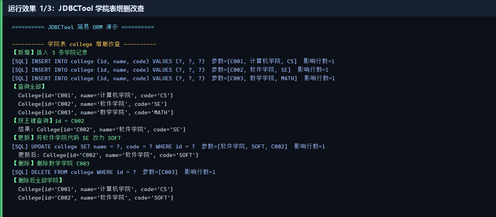
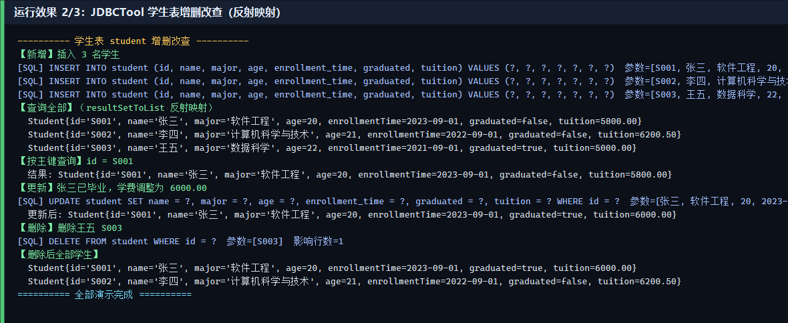
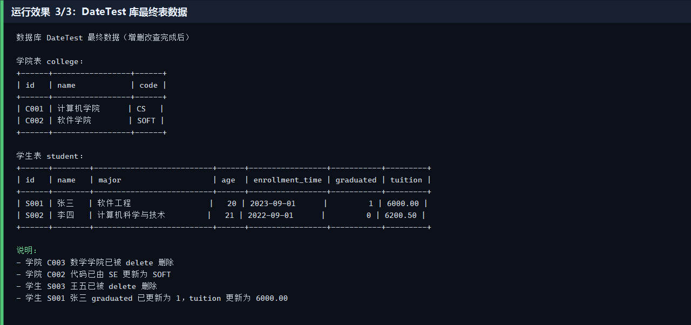

# 作业1：JDBC 工具的设计与开发

基于 **JDBC + Java 反射** 实现的简易 ORM 工具。项目使用 Maven 构建，使用 Git 进行版本管理。

## 一、作业目标完成情况

| 目标 | 实现 |
|------|------|
| 理解 ORM 基本原理 | 用 `@Table` / `@Column` / `@Id` 描述对象与表的映射 |
| 掌握反射创建对象与赋值 | `JDBCTool.resultSetToList` 通过 `Class.newInstance` + `Field.set` 完成 |
| 使用 JDBC 增删改查 | `save` / `update` / `delete` / `getOneById` |
| JDBCTool 五个核心方法 + 辅助方法 | 见 `edu.chenjin.jdbc.util.JDBCTool` |
| DateTest 库：学生表 + 学院表 | `src/main/resources/schema.sql` |
| 对两张表做增删改查演示 | `edu.chenjin.jdbc.demo.JdbcToolDemo` |
| Maven 构建 | `pom.xml` |
| Git 版本管理 | 本仓库 |

## 二、ORM 原理（本项目实现）

```
Java 对象  <──反射读写字段──>  JDBCTool  <──SQL/ResultSet──>  数据库表
   Student                       save/update               student
   College                       resultSetToList           college
```

1. `@Table("student")` 把类映射到表。
2. `@Column("enrollment_time")` 把属性映射到列。
3. `@Id` 标记主键，供更新、删除、按 id 查询使用。
4. 查询时：`ResultSet` → 反射 `newInstance()` → 按列名给字段赋值。
5. 写入时：反射读取对象字段 → 拼装 `INSERT` / `UPDATE` / `DELETE`。

## 三、项目结构

```
.
├── pom.xml
├── README.md
├── src/main/java/edu/chenjin/jdbc
│   ├── annotation/          # @Table @Column @Id
│   ├── entity/              # Student、College
│   ├── util/                # DBUtil、JDBCTool
│   └── demo/JdbcToolDemo    # 增删改查演示
└── src/main/resources
    ├── db.properties
    └── schema.sql
```

## 四、JDBCTool 方法

| 方法 | 作用 |
|------|------|
| `resultSetToList(ResultSet, Class<T>)` | ResultSet 反射映射为对象列表 |
| `save(T, Connection)` | 插入 |
| `update(T, Connection)` | 按主键更新 |
| `delete(T, Connection)` | 按主键删除 |
| `getOneById(String, Class<T>, Connection)` | 按主键查询一条 |
| `queryList` / `findAll` / `executeUpdate` | 统一访问辅助方法 |

## 五、数据库 DateTest

学生表 `student`：id, name, major, age, enrollment_time(入学时间), graduated(是否毕业), tuition(学费)

学院表 `college`：id, name, code

```sql
-- 执行 src/main/resources/schema.sql 即可建库建表
```

默认连接（`src/main/resources/db.properties`）：

```
jdbc.url=jdbc:mysql://localhost:3306/DateTest?...
jdbc.user=root
jdbc.password=********
```

## 六、运行方式

```bash
# 1. 建库建表
mysql -uroot -p < src/main/resources/schema.sql

# 2. 编译并运行演示
mvn -q compile exec:java
```

## 七、运行效果

演示程序会依次对学院表、学生表执行：新增 → 查询全部 → 按 id 查询 → 更新 → 删除。







完整日志见 `docs/screenshots/run-log.txt`。

## 八、Git 仓库

远程仓库 URL：

https://github.com/LQX883/JDBC-

```bash
git clone https://github.com/LQX883/JDBC-.git
```

运行前请复制 `src/main/resources/db.properties.example` 为 `db.properties`，并填入本机 MySQL 密码。
