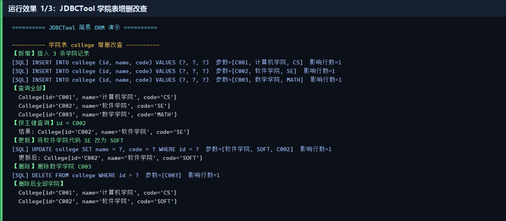
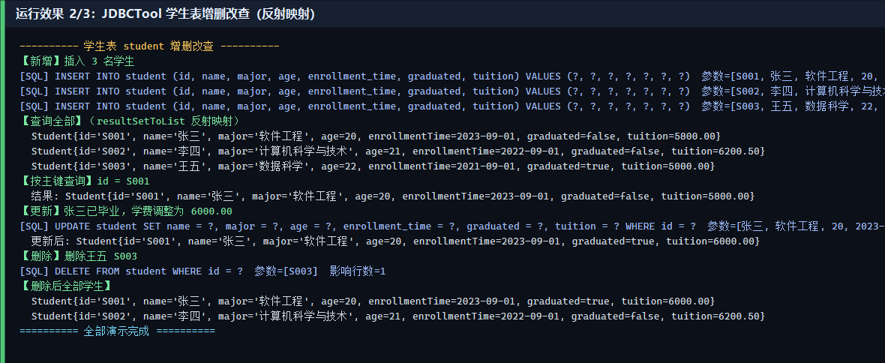
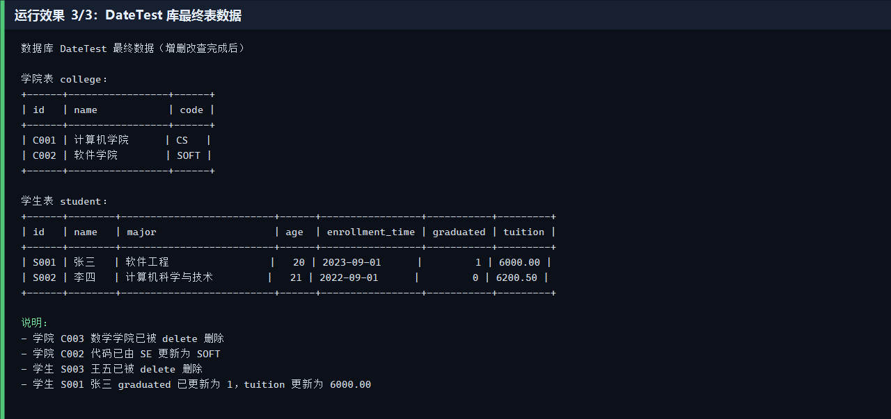

# 答案区

## 9）运行效果截图

演示程序 `JdbcToolDemo` 使用 `JDBCTool` 对 `DateTest` 库的 `college`、`student` 两张表依次执行：新增 → 查询全部（`resultSetToList` 反射映射）→ 按 id 查询 → 更新 → 删除。

### 图1 学院表 college 增删改查

### 图2 学生表 student 增删改查（反射映射）

### 图3 DateTest 库最终表数据

完整控制台日志：`docs/screenshots/run-log.txt`

## 10）仓库 URL 路径

https://github.com/LQX883/JDBC-

- GitHub 仓库：https://github.com/LQX883/JDBC-
- Clone 地址：https://github.com/LQX883/JDBC-.git
- 本地路径：`E:\java\作业1 JDBC工具的设计与开发`
